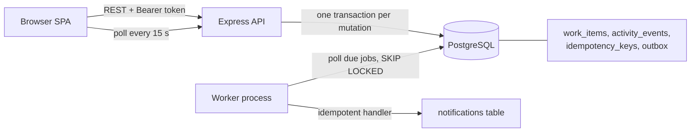

# Operations Under Pressure

An internal web app for creating, assigning, tracking and resolving operational work items across teams
(incidents, customer issues, payments, compliance, tasks). Built for the Newtonite Software Engineering Challenge.

Work items move through a server-enforced workflow with a Lead-only approval step. Every change is recorded in an
append-only activity log. The backend is built to stay correct under concurrency: two people claiming the same item,
stale edits, double-clicks and retried requests.

**Stack:** Node.js 22, TypeScript, Express, PostgreSQL 16 (`pg`, raw SQL), zod, Vitest + Supertest. The frontend is a single
dependency-free HTML/JS page served by the API.

## Run it (one command)

Prerequisite: Docker with Docker Compose.

```bash
docker compose up --build
```

Then open **http://localhost:3000**. On first start the `web` container applies the migration and seeds 4 teams,
10 users and 5,000 work items. The `worker` container processes background notification jobs.

### Demo logins

All demo users have the password **`demo1234`**.

| Username | Role (per team) |
|---|---|
| `admin` | Admin in all four teams |
| `alice` | Lead in Payments and Support |
| `bob` | Lead in Compliance and Platform |
| `carol` | Member in Payments and Support |
| `dave` | Member in Payments |
| `erin` | Member in Compliance |
| `grace` | Member in Platform and Compliance |
| `heidi` | Member in Platform |
| `ivan` | Member in Support only (good for testing "other team" access) |
| `frank` | Viewer in Payments and Compliance |

Things worth trying: open the app in two browsers as `carol` and `dave` and claim the same item from both; or edit the same
item in both and watch the "this item changed" banner appear. Log in as `alice` and use **Awaiting my approval**.

## Run the tests

All tests run against a real PostgreSQL database (concurrency behaviour cannot be proven with a mock).

```bash
docker compose run --rm web npm test
```

Without Docker (needs Node 22+ and a local Postgres whose user may create databases):

```bash
npm install
export POSTGRES_HOST=localhost POSTGRES_USER=ops POSTGRES_PASSWORD=ops   # see .env.example
npm test          # creates and migrates a separate "ops_test" database automatically
```

To run the app locally instead of in Docker: `npm run migrate && npm run seed && npm run dev`, and in another
terminal `npm run worker`.

## What is tested

| Behaviour | Test |
|---|---|
| Two users claim the same item | 4 parallel claims, 10 rounds: exactly one wins, the others get 409 `already_claimed` |
| Stale edit | Old `version` is rejected with 409 and the latest item; data and history unchanged. Also a parallel race |
| Duplicate request | Same `Idempotency-Key` creates one item and replays the stored response (sequential and 6 concurrent) |
| Workflow rules | Invalid jumps rejected; only a Lead of the team can approve; four-eyes rule; Members move only their own items |
| Resource-level authorization | Other-team user gets 404 on every read and write; Viewers cannot write; Lead-only assignment |
| Reliable async jobs | Job written in the same transaction; processed twice = one notification; retry with backoff; marked failed after max attempts |
| History consistency | If writing the activity event fails, the item change is rolled back too; history is append-only at database level |
| Pagination / filters | Keyset pagination returns every item once and stays consistent while new items arrive; filters and search are server-side; the hot query uses an index |

## API overview

All endpoints except login need `Authorization: Bearer <token>`. Mutating endpoints accept an optional `Idempotency-Key` header.

| Method and path | Purpose |
|---|---|
| `POST /api/auth/login` | `{username, password}` returns `{token, user}` |
| `GET /api/me` | Current user with team roles |
| `GET /api/dashboard` | Counts for "assigned to me", "unassigned urgent", "awaiting my approval" |
| `GET /api/items` | Server-side filters `view, status, priority, type, team_id, assignee (me/none/id), q`, plus `limit` and `cursor` |
| `POST /api/items` | Create an item |
| `GET /api/items/:id` | Detail, including `permissions` for the caller |
| `PATCH /api/items/:id` | Edit; requires the current `version` (409 on mismatch) |
| `POST /api/items/:id/claim` | Atomic self-assignment of an unassigned open item |
| `POST /api/items/:id/assign` | Lead/Admin: assign or unassign (`{assignee_id, version}`) |
| `POST /api/items/:id/transition` | `{to, version?}`, follows the workflow rules |
| `POST /api/items/:id/comments` | Add a comment |
| `GET /api/items/:id/activity` | Paginated history, newest first |
| `GET /api/teams/:id/members` | Team members (for the assign dropdown) |
| `GET /api/notifications` | Notifications created by the worker |

Errors are JSON: `{code, message, ...}`. Conflicts return 409 with codes `version_conflict` (includes `latest`),
`already_claimed`, `invalid_transition`, `assignee_required`.

## Architecture



A mutating request opens one transaction that contains: the idempotency-key row, the guarded `UPDATE` on the item, the
activity event, and (when relevant) the outbox job. They commit together or not at all.

Source layout: `src/items.ts` (business rules), `src/workflow.ts` (state machine), `src/permissions.ts` (role matrix),
`src/outbox.ts` (jobs), `src/app.ts` (routes, idempotency), `migrations/001_init.sql` (schema, indexes, constraints).

## Product assumptions

**States:** `open -> in_progress -> awaiting_approval -> resolved -> closed`. Extra allowed moves: `in_progress -> open`,
`awaiting_approval -> in_progress` (reject), `resolved -> in_progress` (reopen). `closed` is final.

| Role (per team) | Can |
|---|---|
| Viewer | Read |
| Member | Create, edit, comment, claim; move items **assigned to them** |
| Lead | Everything a Member can, plus assign/unassign, move any item, approve/reject/close |
| Admin | Same as Lead, and may also approve items assigned to themselves |

Other assumptions: only an `open` item can be unassigned; starting work requires an assignee; approving is separate from doing
the work (a Lead cannot approve their own item). See `ENGINEERING_DECISIONS.md` for the reasoning and trade-offs.

## Known limitations

- Tokens do not expire and there is no login rate limiting (acceptable for a demo).
- Search matches item titles (and `#id`) only, using a trigram index; it is not full-text search over descriptions.
- Lists are ordered newest-first by id. There is no sort by priority or due date.
- Notification "delivery" writes a row to a `notifications` table (shown in the UI); there is no email or push.
- Idempotency keys and finished outbox rows are never purged.
- The worker polls every 2 seconds; there is no `LISTEN/NOTIFY` wake-up.
- No user or team management screens, password change, or sign-up (users are seeded).
- The UI is intentionally minimal and refreshes by polling (counts and notifications every 15 s).
- The browser UI was exercised with an automated headless DOM, not across real browsers.

## Next week I would

1. Add token expiry/revocation and rate limiting on login.
2. Add Postgres full-text search (`tsvector` + GIN) including descriptions, and sort options with matching indexes.
3. Use `LISTEN/NOTIFY` so the worker reacts instantly; add a cleanup job for old idempotency keys and finished jobs.
4. Add due-date/SLA escalation (a scheduled job that raises priority and notifies the Lead).
5. Add browser-level (Playwright) tests for optimistic-update rollback.
